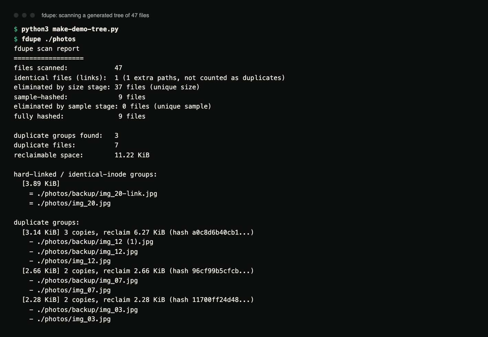
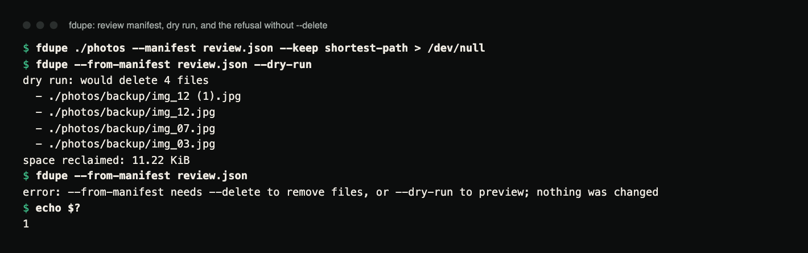

# fdupe

Find duplicate files by content across large directory trees, in parallel,
without hashing bytes it doesn't have to, and without deleting anything until
you've reviewed exactly what it plans to do.

[](https://github.com/hellpuffyt/fdupe/actions/workflows/ci.yml)
[](LICENSE)

**Status:** version 0.1.0. Rust 1.88 or newer. CI tests on Linux, macOS and
Windows. Not published to crates.io; install from source.

## What

`fdupe` scans one or more directories, finds files whose contents are
byte-for-byte identical, and reports them grouped together with the total
space you'd reclaim by keeping one copy of each. It never deletes anything
unless you explicitly ask it to, and even then only through a narrow,
auditable path.

## Demo

A generated tree of 47 files: 40 random "photos" of different sizes, copies
of three of them in `backup/` (one copied twice), one hard link, and two
same-size files that share their first and last 4 KiB but differ in the
middle:

```python
# make-demo-tree.py
import os, random, shutil
rng = random.Random(7)
os.makedirs("photos/backup", exist_ok=True)
for i in range(1, 41):
    with open(f"photos/img_{i:02}.jpg", "wb") as f:
        f.write(rng.randbytes(2048 + i * 97))
shutil.copy("photos/img_03.jpg", "photos/backup/img_03.jpg")
shutil.copy("photos/img_07.jpg", "photos/backup/img_07.jpg")
shutil.copy("photos/img_12.jpg", "photos/backup/img_12.jpg")
shutil.copy("photos/img_12.jpg", "photos/backup/img_12 (1).jpg")
os.link("photos/img_20.jpg", "photos/backup/img_20-link.jpg")
head, tail = rng.randbytes(4096), rng.randbytes(4096)
for name in ("scan_a.tif", "scan_b.tif"):
    with open(f"photos/{name}", "wb") as f:
        f.write(head + rng.randbytes(1000) + tail)
```

```
$ fdupe ./photos
fdupe scan report
==================
files scanned:            47
identical files (links):  1 (1 extra paths, not counted as duplicates)
eliminated by size stage: 37 files (unique size)
sample-hashed:             9 files
eliminated by sample stage: 0 files (unique sample)
fully hashed:              9 files

duplicate groups found:   3
duplicate files:          7
reclaimable space:        11.22 KiB

hard-linked / identical-inode groups:
  [3.89 KiB]
    = ./photos/backup/img_20-link.jpg
    = ./photos/img_20.jpg

duplicate groups:
  [3.14 KiB] 3 copies, reclaim 6.27 KiB (hash a0c8d6b40cb1...)
    - ./photos/backup/img_12 (1).jpg
    - ./photos/backup/img_12.jpg
    - ./photos/img_12.jpg
  [2.66 KiB] 2 copies, reclaim 2.66 KiB (hash 96cf99b5cfcb...)
    - ./photos/backup/img_07.jpg
    - ./photos/img_07.jpg
  [2.28 KiB] 2 copies, reclaim 2.28 KiB (hash 11700ff24d48...)
    - ./photos/backup/img_03.jpg
    - ./photos/img_03.jpg
```



*Terminal capture of the scan above (real output, rendered from the saved
transcript).*

The hard link is reported as an identity group, not a duplicate. The two
`scan_*.tif` files survive the sample stage (identical head and tail) and are
only told apart by the full hash, which is the case stage 3 exists for.

Reviewing a delete plan before anything is removed:



*Terminal capture: writing a review manifest, previewing it with `--dry-run`,
and the refusal (exit 1) when `--delete` is not given.*

## Why

Most duplicate finders pick one of two bad defaults: they hash the full
contents of every file up front (slow on large trees), or they guess at
duplicates from filenames or sizes and delete on that guess (unsafe).
`fdupe` is fast because it's lazy about reading bytes, and safe because
deciding *that* something is a duplicate is a separate step from deciding
*what to do about it*.

## How the cascade works

Comparing file contents is the expensive part, so `fdupe` avoids it for as
long as possible using three stages, each run only on files that survived the
last:

1. **Group by size.** Two files of different sizes cannot be identical. This
   costs nothing, since the size is already in the metadata from the
   directory walk. Most trees have few files sharing an exact size, so this
   alone eliminates most candidates.
2. **Sample hash.** For files that share a size with at least one other file,
   hash the first 4 KiB and the last 4 KiB (`--sample-size` changes this).
   Files of 8 KiB or less are hashed in full here, since that's cheaper than
   reading twice. Files with different content almost always differ
   somewhere in that sample, so this eliminates almost everything that made
   it past stage 1.
3. **Full hash.** Only files that share both size *and* sample hash (the rare
   case where two different files start and end the same way) get their
   entire contents streamed through the hash. This is the only stage that
   is actually expensive, which is why it runs last and on the fewest files.

All hashes are SHA-256. The report shows how many files were eliminated at
each stage, so you can see the cascade working: on a real tree,
`fully_hashed` is typically a small fraction of `files_scanned`.

Hard links (and, with `--follow-symlinks`, symlinks) pointing at the same
underlying file are detected up front and reported as an *identity* group,
separate from content duplicates. They're one file with two names, and
deleting one wouldn't reclaim anything.

## Features

- Three-stage size → sample → full-hash cascade with per-stage stats.
- Parallel hashing via [`rayon`](https://docs.rs/rayon)'s work-stealing pool
  (see [Parallelism](#parallelism) below).
- Hard-link / same-inode detection, reported separately from duplicates.
- `--min-size`, `--exclude <glob>` (repeatable, matched against the full
  path), `--follow-symlinks` (off by default), `--sample-size`.
- Safe deletion: `--delete` requires `--keep <strategy>`, supports
  `--dry-run`, and refuses to delete every copy of a group. Before anything
  in a group is removed, the kept copy is checked to still exist and still
  match, and every file to be removed is re-hashed.
- JSON review manifest (`--manifest`) that `--from-manifest --delete` later
  executes under the same checks.
- Unreadable entries (permission denied, symlink loops, files that vanish
  mid-scan) are skipped and counted in the report rather than aborting the
  scan; a root path that does not exist is an error.
- Human-readable or `--json` output (`duplicate_groups`, `identity_groups`
  and `stats`, including `reclaimable_bytes`).

### Parallelism

Hashing is CPU- and IO-bound work over an independent list of files with no
coordination needed between them, a textbook data-parallel workload.
`rayon`'s `par_iter` sizes its pool to the available cores and handles work
stealing, which fits better than hand-rolled `std::thread` + channel plumbing
and leaves far less code to get wrong.

## Installation

Requires a Rust toolchain, 1.88 or newer.

```sh
git clone https://github.com/hellpuffyt/fdupe.git
cd fdupe
cargo install --path .
```

This puts `fdupe` in `~/.cargo/bin`. To try it without installing, use
`cargo run --release -- <args>`.

## Usage

```
fdupe [OPTIONS] [PATHS]...
```

`PATHS` defaults to the current directory. Run `fdupe --help` for the full
option list.

```sh
# Scan the current directory, print a human-readable report
fdupe .

# Scan multiple trees, ignore anything under node_modules, and
# skip files smaller than 1 KiB
fdupe ~/Photos ~/Backups --exclude "**/node_modules/**" --min-size 1024

# Machine-readable output
fdupe . --json
```

Exit codes: `0` on success (including a delete run that skipped files which
changed), `1` on any error: a missing root path, `--delete` without `--keep`,
`--from-manifest` without `--delete` or `--dry-run`, or a manifest group
that had to be refused.

### Safety model

Deletion is deliberately harder than reporting:

```sh
# 1. See what's there. Nothing is touched.
fdupe .

# 2. Write a review manifest describing exactly what would be kept and
#    deleted, without deleting anything. (The scan report is printed too.)
fdupe . --manifest review.json --keep shortest-path

# 3. Inspect review.json by hand. It's plain JSON: one entry per
#    duplicate group, with its size, hash, a `keep` path and a `delete` list.

# 4. Preview, then execute exactly that plan (`--delete` is required).
#    The kept copy of each group must still exist and match, or the whole
#    group is refused. Each file to delete is re-hashed immediately before
#    deletion; if it changed since step 2, it is skipped.
fdupe --from-manifest review.json --dry-run
fdupe --from-manifest review.json --delete
```

If you'd rather skip the manifest step, `--delete` runs the same plan
immediately, with the same re-verification (files can change between being
hashed during the scan and being deleted):

```sh
fdupe . --delete --keep first --dry-run   # preview
fdupe . --delete --keep first             # actually delete
```

`--keep` strategies:

| Strategy         | Keeps                                            |
|------------------|---------------------------------------------------|
| `first`          | The path that sorts first lexicographically        |
| `oldest`         | The file with the earliest modification time       |
| `newest`         | The file with the latest modification time         |
| `shortest-path`  | The file with the shortest path (ties broken lexicographically) |

`first` compares whole paths, so in the demo above it keeps
`./photos/backup/img_12 (1).jpg` (because `backup/` sorts before `img_`);
`shortest-path` keeps `./photos/img_12.jpg`. Check the manifest before
running `--delete`.

`fdupe` always keeps at least one file per duplicate group. If a manifest
(hand-edited or otherwise) would result in every copy of a group being
deleted (the kept path also listed for deletion, under any spelling or as a
hard link, or the kept file missing or changed since the manifest was
written), that group is refused and reported, nothing in it is touched, and
the command exits non-zero.

Without `--delete`, nothing is ever removed: scanning, `--json`,
`--manifest` (which only writes the manifest file you name) and every
`--dry-run` leave the scanned tree untouched. `--skip-verify` turns off the
re-hashing (not the kept-copy existence check) and is not recommended.

Remaining limits: there is an unavoidable window between verifying a file
and removing it, and with `--follow-symlinks` a duplicate "copy" can be a
symlink, in which case deleting it removes only the link.

### Platform differences

Identity detection (hard links / same file via a followed symlink) uses
`(device, inode)` on Unix-like systems and the NTFS file index on Windows
(via [`same-file`](https://docs.rs/same-file)). On some filesystems, notably
certain network shares, a reliable file index isn't available. Those files
then aren't merged into an identity group and fall through to ordinary
content comparison, which is safe: at worst, a hard-linked pair shows up as
an ordinary duplicate group instead of an identity group.

## Benchmarks

No recorded benchmark numbers yet. The per-stage counters in every report
(`sample_hashed` and `fully_hashed` against `files_scanned`) are the
reproducible evidence that it does far less full-file hashing than a
hash-everything approach on any tree with more unique-sized files than
duplicates, which is the common case.

## Testing

```sh
cargo test --all-targets
cargo fmt --all -- --check
cargo clippy --all-targets -- -D warnings
```

70 tests (0 ignored). The suite builds real directory trees with `tempfile`
and covers: identical-content detection, the same-size/different-content
false positive guard, empty files, single-file trees, nested directories,
exclude globs, the min-size filter, hard-link identity grouping, each
`--keep` strategy choosing the correct survivor, the refusal to delete every
copy of a group, manifest round-tripping and re-verification, and that the
cascade actually short-circuits (a uniquely sized file is never sample- or
fully-hashed). `tests/safety_tests.rs` covers the deletion safety rules: a
kept copy deleted or modified after the manifest was written, the kept file
listed again under another spelling or as a hard link, files changed between
scan and `--delete`, `--from-manifest` without `--delete`, report-only modes
leaving the tree byte-for-byte unchanged, symlink loops, unreadable
directories and files (Unix; these must run as a non-root user), and files
growing during the scan.

CI runs the tests on Linux, macOS and Windows, fmt and clippy, an MSRV build
with Rust 1.88.0, and a release-binary smoke test. The last audit is in
[docs/PRODUCTION_READINESS.md](docs/PRODUCTION_READINESS.md).

## Security

`fdupe` only reads the file contents and metadata it's pointed at, and only
writes to disk when you pass `--delete` (which removes files) or
`--manifest` (which writes the manifest file you name). It contains no
`unsafe` code (`#![forbid(unsafe_code)]`, also enforced in `Cargo.toml`). If you find a
security issue, please report it privately as described in
[SECURITY.md](SECURITY.md) rather than opening a public issue.

## Contributing

See [CONTRIBUTING.md](CONTRIBUTING.md). Changes are listed in
[CHANGELOG.md](CHANGELOG.md).

## License

MIT. See [LICENSE](LICENSE).
